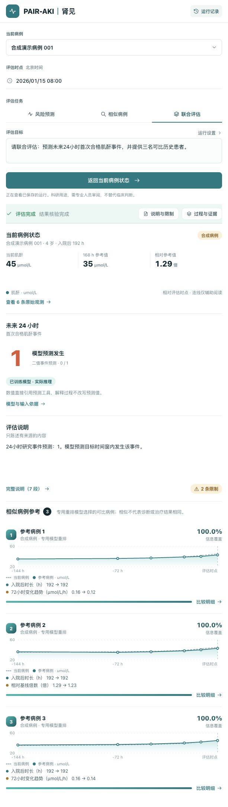
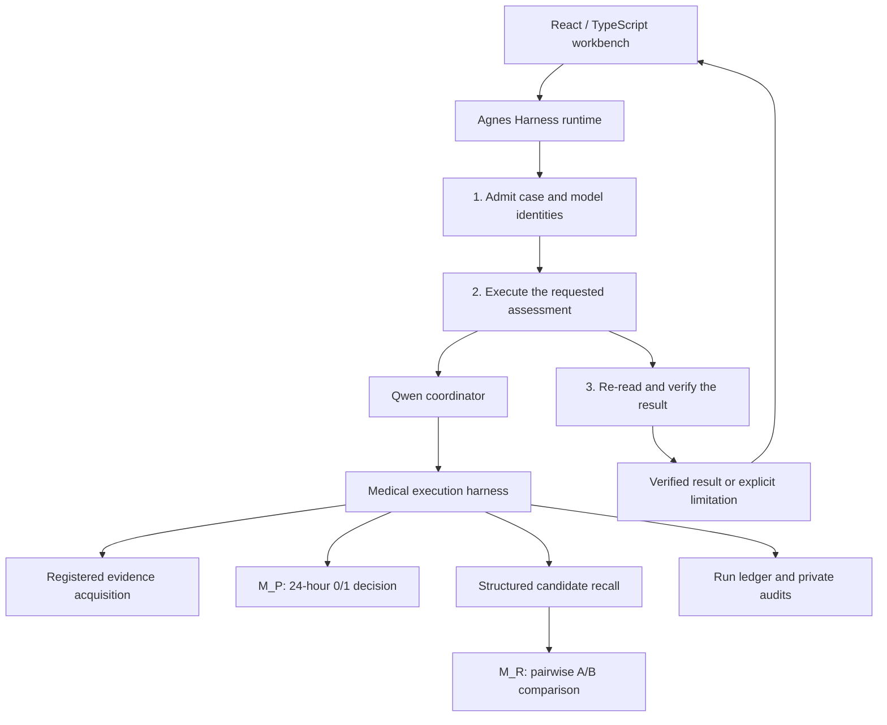

# PAIR-AKI · 肾见

English | [简体中文](README.zh-CN.md)

**Prediction And Intelligent Retrieval for pediatric AKI research.**

A research agent that combines a binary 24-hour creatinine-event predictor, comparable-case retrieval, and an auditable execution workflow.

[](LICENSE)
[](pyproject.toml)
[](https://github.com/njmu-edu/PAIR-AKI/actions/workflows/check.yml)

[Overview](#project-overview) · [Demo video](#demo-video) · [Architecture](#architecture) · [Integration standards](#integration-standards) · [Quick start](#quick-start)

## Project Overview

Children's creatinine measurements must be interpreted against age, baseline values, observation times, and changing hospital courses. A prediction without its applicable time point or supporting context is difficult to review. PAIR-AKI organizes this work into two independent medical application capabilities and records how each result was obtained.

| Capability | Method | Business output |
| --- | --- | --- |
| **24-hour event prediction** | A dedicated Qwen3.5-4B decision model, `M_P`, selects between native candidates `0` and `1` | An integer `label: 0 \| 1`, with model and input receipts |
| **Comparable-case retrieval** | Structured recall of up to 12 distinct patients, followed by an independently trained Qwen3.5-4B pairwise reranker, `M_R` | Up to 3 distinct patients, similarities, important differences, and source references |
| **Autonomous coordination** | A larger Qwen coordinator proposes short plans; the medical harness validates and executes them | A completed assessment, a supported partial result, a clarification, or an explicit failure |

The prediction target is the study-defined **first qualifying serum-creatinine event within the next 24 hours**. It does not cover urine-output criteria or establish a complete clinical AKI diagnosis. Unavailable information or a failed model call is never converted into a negative prediction.

### What the project adds

- **Independent decisions for separate tasks.** Prediction uses finite candidates `0/1`; reranking uses `A/B`. The research implementation trains and exports the two models separately. A request for retrieval does not force a prediction call.
- **Feedback-driven task execution.** The coordinator can read the case state, acquire registered evidence, invoke an applicable capability, clarify the goal, or stop. Eligibility and tool permissions remain executable checks.
- **Atomic evidence updates.** A failed evidence request leaves the accepted case state intact. A successful state update invalidates results tied to the old input.
- **Reviewable explanations.** Deterministic tools construct numeric statements, differences, and source references. The LLM organizes verified statements without rewriting the prediction.
- **A real AGH execution chain.** Agnes Harness runs three dependent application stages and records native tool calls and feedback. Our medical harness supplies the domain-specific checks.

### Public release scope

This repository contains the portable agent core, synthetic cases, the React workbench, model-provider contracts, tests, and the pinned AGH adapter. The trained medical adapters, hospital datasets, and private deployment configuration are **not distributed**. The default quick start uses explicitly labelled synthetic tool providers and a scripted coordinator for installation checks. Connect a local OpenAI-compatible coordinator and your own compatible medical services for live inference.

Engineering runs and rule-based retrieval evaluations do not establish clinical effectiveness. The case-comparison training preference comes from structured rules, not independent physician relevance labels. This is research software for professional review.

<details>
<summary>Synthetic demonstration screenshot</summary>



The screenshot is from a synthetic-input engineering demonstration. It contains no real patient records. It is an example of the workbench, not a promise that the default scripted quick start reproduces the displayed trained-model result.

</details>

## Demo Video

[**Original-quality demo · 1080p · 346.73 MB**](https://github.com/njmu-edu/PAIR-AKI/releases/download/demo-2026-11-01/PAIR-AKI-demo-original-1080p.mp4) · [Both video versions](https://github.com/njmu-edu/PAIR-AKI/releases/tag/demo-2026-11-01)

| Version | File | Size | Video encoding | Duration |
| --- | --- | --- | --- | --- |
| **Original quality (primary)** | [PAIR-AKI-demo-original-1080p.mp4](https://github.com/njmu-edu/PAIR-AKI/releases/download/demo-2026-11-01/PAIR-AKI-demo-original-1080p.mp4) | **346.73 MB / 330.67 MiB** (346,731,030 bytes) | 1920 × 1080, HEVC/H.265 | About 4 min 48 s |
| Compressed (retained alternative) | [PAIR-AKI-demo.mp4](https://github.com/njmu-edu/PAIR-AKI/releases/download/demo-2026-11-01/PAIR-AKI-demo.mp4) | **24.52 MB / 23.39 MiB** (24,523,785 bytes) | 960 × 544, H.264 | About 4 min 48 s |

The original-quality version is the primary video. The earlier compressed video, its URL, and the existing commits remain available. If your browser cannot play HEVC, download the original or use the smaller H.264 version. MB uses 1,000,000 bytes; MiB uses 1,048,576 bytes.

The team-provided recording presents the project and demonstrates prediction, comparable-case retrieval, and execution evidence. The public quick-start remains a separately labelled synthetic-fixture workflow. Both videos are release attachments, outside the source history; model weights and dataset files are not included.

## Architecture



The AGH adapter schedules the outer application workflow. The inner agent makes the medical tool-selection decisions. AGH records actual tool execution; PAIR-AKI implements time eligibility, model identity, atomic updates, patient exclusion, and result/reference checks. The fixed outer dependencies are integration logic, not a claim of learned autonomous planning.

| Module | Responsibility |
| --- | --- |
| `pair_aki/autonomous/` | Goal interpretation, short plans, budgets, medical admission, recall, reports, and immutable terminal states |
| `pair_aki/backend/` | Time-qualified snapshots, synthetic fixtures, source/reference checks, and persistence |
| `pair_aki/specialists/` | Independent role contracts, synthetic providers, support signatures, and structured comparison rules |
| `pair_aki/medical_provider.py` | Optional adapters for separately hosted, identity-bound trained medical services |
| `pair_aki/compat/` and `agh/` | The three-stage AGH bridge, gateway, source pin, and build |
| `web/` | The single-screen workbench and evidence drawer |

See [Architecture](ARCHITECTURE.md) / [架构介绍](ARCHITECTURE.zh-CN.md) for execution boundaries, state transitions, and recovery.

## Integration Standards

- **Application API:** versioned JSON endpoints under `/api/competition/v2`; UTF-8 and `application/json`.
- **Input identity:** `case_ref`, `snapshot_ref`, and a natural-language `goal`; tools bind their receipts to the accepted snapshot.
- **Time and provenance:** ISO 8601 evaluation timestamps, explicit observation/availability offsets, source kind, version, and SHA-256 input identities. Future observations are not prediction inputs.
- **Prediction:** strict integer `0/1`. Model failure, unsupported input, clarification, and blocked states remain separate from the label. Probabilities and candidate logits stay outside the business response.
- **Retrieval:** query-patient exclusion across admissions, one selected time point per reference patient, no future outcome in recall/reranking, and no invented patient identifiers.
- **Model services:** a local OpenAI-compatible chat endpoint for coordination; independent `M_P` and `M_R` provider interfaces for medical decisions.
- **Execution evidence:** AGH session ID, native ledger, model-action receipts, tool trace, application run ID, and verification status. Redacted exports must be marked and hashed separately from originals.

See [Integration standards and API](INTEGRATION.md) / [集成标准与接口](INTEGRATION.zh-CN.md) for payloads, endpoint contracts, and AGH startup.

## Quick Start

Python **3.11+** is sufficient for the synthetic contract tests and API. Node.js **24.10+** is used for the pinned AGH integration and frontend builds. The service examples target Linux/macOS; GPU medical services are separate optional processes.

```sh
git clone https://github.com/njmu-edu/PAIR-AKI.git
cd PAIR-AKI
python3 -m venv .venv
. .venv/bin/activate
make test

# Optional: build the workbench once.
make web-install
make web-build

# Explicitly synthetic medical tools + scripted installation workflow.
make demo
```

Open `http://127.0.0.1:30886` after building the frontend. In another terminal:

```sh
python3 -m pair_aki.cli --list
python3 -m pair_aki.cli --goal 'Combined assessment: predict the 24-hour event and retrieve comparable cases.'
```

The API advertises `coordinator.mode=scripted_test` and medical `mode=synthetic` in this quick start. It is an installation check and does **not** execute AGH or a trained medical model. For the real three-stage runtime, follow [Run through AGH](INTEGRATION.md#run-through-agh). No model weights are downloaded automatically.

### Live coordinator

```sh
export PAIR_AKI_MODEL_URL=http://127.0.0.1:8000/v1
export PAIR_AKI_MODEL=your-served-model-id
# Set PAIR_AKI_MODEL_API_KEY in the environment only if the local service requires it.
make serve
```

This replaces the scripted coordinator while keeping synthetic medical tools. To use separately hosted trained providers, configure the two medical URLs and start the server without `--synthetic-medical`; see the integration guide. Every provider reports its actual mode and identity; no silent fallback occurs.

## Development

```sh
make check                    # Agent tests + publication-boundary scan
make web-build                # TypeScript check + Vite production build
make web-dev                  # Workbench with same-origin API proxy
```

Runtime state defaults to a directory outside this checkout. Clinical uploads, arbitrary SQL/shell tools, and public authentication are outside this reference server's scope. Keep the API on loopback; add a reviewed access layer before exposing any non-synthetic deployment.

## License and Attribution

Original code in this public release is licensed under [Apache-2.0](LICENSE). [Agnes Harness](https://github.com/AgnesAI-Labs/agnes-harness) is fetched separately at the revision declared in `agh/upstream-manifest.json`; its license and notice are preserved in `third_party/`. Qwen weights and private adapters are not included. See [third-party notices](THIRD_PARTY.md).
