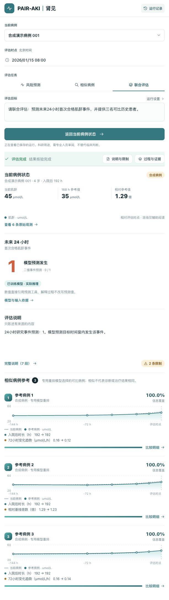
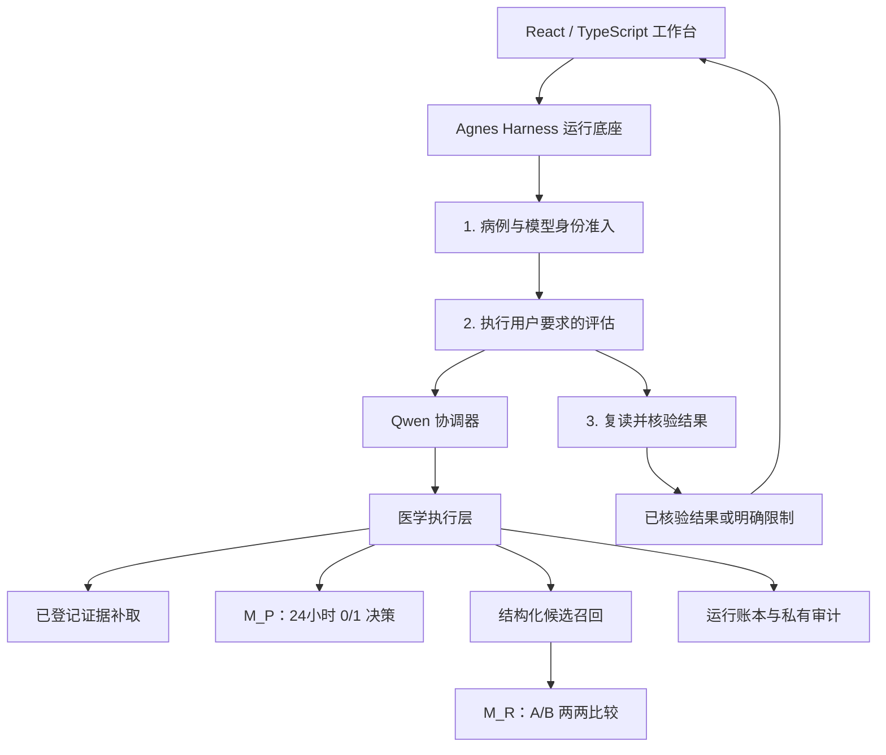

# PAIR-AKI · 肾见

[English](README.md) | 简体中文

**Prediction And Intelligent Retrieval：面向儿童AKI研究的预测与智能病例检索。**

将24小时肌酐事件二值预测、可比病例检索和可审阅的执行流程放进同一个科研Agent。

[](LICENSE)
[](pyproject.toml)
[](https://github.com/njmu-edu/PAIR-AKI/actions/workflows/check.yml)

[项目介绍](#项目介绍) · [视频介绍](#视频介绍) · [架构介绍](#架构介绍) · [集成标准](#集成标准) · [快速开始](#快速开始)

## 项目介绍

儿童肌酐数据需要结合年龄、既往参考值、观测时间和住院病程解释。缺少适用时点和依据的预测结果，难以审阅。PAIR-AKI把这一工作拆成两项独立医学应用能力，并记录每项结果的实际取得过程。

| 能力 | 实现方式 | 业务输出 |
| --- | --- | --- |
| **24小时事件预测** | 专用Qwen3.5-4B决策模型 `M_P` 在原生候选 `0/1` 中选择 | 严格整数 `label: 0 \| 1`，附模型及输入回执 |
| **可比病例检索** | 结构化召回最多12名不同患者，独立训练的Qwen3.5-4B重排器 `M_R` 两两比较 | 最多3名不同患者，附相似处、关键差异和来源 |
| **自主任务编排** | 较大的Qwen协调器提出短计划，医学执行层核验并执行 | 完整评估、有依据的部分结果、澄清或明确失败 |

预测端点是研究定义的**未来24小时首次合格肌酐事件**，不覆盖尿量标准，也不等同于完整临床AKI诊断。资料不足或模型调用失败不会转换成阴性预测。

### 核心设计与创新亮点

- **两项任务分别决策。** 预测学习有限候选 `0/1`，重排学习有限候选 `A/B`。研究实现分别训练、导出两个模型。用户只要求检索时，不额外强制调用预测器。
- **根据反馈推进任务。** 协调器可以读取病例状态、补取已登记证据、调用合格医学能力、澄清目标或结束。数据资格和工具权限由执行层核验。
- **补证原子更新。** 补证失败时保留原已接纳状态；补证成功后，旧输入对应的结果失效。
- **解释可审阅。** 确定性工具产生数值陈述、病例差异和来源引用，大模型组织已核验陈述，不改写预测值。
- **AGH实际执行链。** Agnes Harness调度三个有依赖关系的应用阶段，保存原生工具调用与反馈；本项目医学执行层提供领域检查。

### 公开版本范围

本仓库包含可移植Agent核心、合成病例、React工作台、模型提供器合同、测试和固定版本AGH适配。**不分发**医学模型私有适配器、医院数据集和私有部署配置。默认快速开始使用明确标记的合成工具提供器及脚本协调器，用于安装与流程核验；接入本地OpenAI兼容协调服务和自备医学模型服务后可执行真实模型调用。

工程运行及规则参照检索评价不能证明临床有效性。病例比较训练偏好来自结构化规则，不是独立医生相关性标注。本项目为供专业人员审阅的研究软件。

<details>
<summary>查看合成病例演示截图</summary>



截图来自合成输入的工程演示，不含真实患者资料。它展示工作台形态，不表示默认脚本快速开始会复现图中已训练模型的结果。

</details>

## 视频介绍

[**原画质演示视频 · 1080p · 346.73 MB**](https://github.com/njmu-edu/PAIR-AKI/releases/download/demo-2026-11-01/PAIR-AKI-demo-original-1080p.mp4) · [两个视频版本](https://github.com/njmu-edu/PAIR-AKI/releases/tag/demo-2026-11-01)

| 版本 | 文件 | 文件大小 | 视频编码 | 时长 |
| --- | --- | --- | --- | --- |
| **原画质版（主推荐）** | [PAIR-AKI-demo-original-1080p.mp4](https://github.com/njmu-edu/PAIR-AKI/releases/download/demo-2026-11-01/PAIR-AKI-demo-original-1080p.mp4) | **346.73 MB / 330.67 MiB**（346,731,030字节） | 1920 × 1080，HEVC/H.265 | 约4分48秒 |
| 压缩版（保留备用） | [PAIR-AKI-demo.mp4](https://github.com/njmu-edu/PAIR-AKI/releases/download/demo-2026-11-01/PAIR-AKI-demo.mp4) | **24.52 MB / 23.39 MiB**（24,523,785字节） | 960 × 544，H.264 | 约4分48秒 |

主入口采用原画质版，此前的压缩视频、原链接和已有提交记录全部保留。浏览器不支持HEVC播放时，可下载原画质版或选择更小的H.264压缩版。MB按1,000,000字节计算，MiB按1,048,576字节计算。

团队提供的录像包含项目介绍与工作台操作，展示预测、可比病例检索及执行证据。公开快速开始仍采用单独标记的合成样例流程。两个视频均为Release附件，不进入源码历史，也不包含模型权重或数据集文件。

## 架构介绍



AGH适配负责外层应用流程调度，内层Agent负责医学工具选择。AGH记录实际工具执行；PAIR-AKI实现时点资格、模型身份、原子更新、患者排除及结果/引用核验。外层固定依赖顺序属于集成逻辑，不作为学习型自主规划的贡献。

| 模块 | 职责 |
| --- | --- |
| `pair_aki/autonomous/` | 目标理解、短计划、预算、医学准入、召回、报告与不可修改终态 |
| `pair_aki/backend/` | 时间合格的病例快照、合成样例、来源/引用核验与持久化 |
| `pair_aki/specialists/` | 独立角色合同、合成提供器、支持范围和结构化比较规则 |
| `pair_aki/medical_provider.py` | 外接独立部署、具有身份绑定的医学模型服务 |
| `pair_aki/compat/` 与 `agh/` | AGH三阶段桥接、网关、上游版本固定和构建 |
| `web/` | 单屏工作台和证据抽屉 |

执行边界、状态转换和恢复详见[架构介绍](ARCHITECTURE.zh-CN.md) / [Architecture](ARCHITECTURE.md)。

## 集成标准

- **应用接口：** `/api/competition/v2` 下的版本化JSON接口，使用UTF-8和 `application/json`。
- **输入身份：** 病例引用 `case_ref`、快照引用 `snapshot_ref` 和自然语言 `goal`；工具回执绑定已接纳快照。
- **时间与来源：** ISO 8601评估时间、明确的观测/可用时刻偏移、来源类型、版本和SHA-256身份。预测输入不包含未来观测。
- **预测输出：** 严格整数 `0/1`。故障、不适用、澄清和受阻使用独立状态；概率及候选logit不进入业务响应。
- **病例检索：** 排除查询患者的全部住院，每名参考患者选择一个时点，召回/重排不使用未来结局，不虚构患者身份。
- **模型服务：** 协调器使用本地OpenAI兼容接口，医学决策分别遵循 `M_P` 与 `M_R` 提供器合同。
- **执行证据：** AGH session ID、原生账本、模型动作回执、工具轨迹、应用run ID与核验状态；脱敏导出必须标记，并与原件分别计算哈希。

请求示例、接口合同与AGH启动见[集成标准与接口](INTEGRATION.zh-CN.md) / [Integration standards and API](INTEGRATION.md)。

## 快速开始

合成合同测试及API只需要 **Python 3.11+**；固定AGH适配与前端构建使用 **Node.js 24.10+**。服务命令面向Linux/macOS，GPU医学服务是独立可选进程。

```sh
git clone https://github.com/njmu-edu/PAIR-AKI.git
cd PAIR-AKI
python3 -m venv .venv
. .venv/bin/activate
make test

# 可选：构建一次工作台。
make web-install
make web-build

# 明确使用合成医学工具和脚本安装验证流程。
make demo
```

构建前端后访问 `http://127.0.0.1:30886`。另一个终端中执行：

```sh
python3 -m pair_aki.cli --list
python3 -m pair_aki.cli --goal '请联合评估：预测未来24小时首次合格肌酐事件，并提供三名可比历史患者。'
```

默认能力接口明确显示 `coordinator.mode=scripted_test` 和医学 `mode=synthetic`。该入口只用于安装核验，**不执行AGH，也不加载已训练医学模型**。实际三阶段底座接入见[通过AGH运行](INTEGRATION.zh-CN.md#通过agh运行)，不会自动下载模型权重。

### 接入真实协调模型

```sh
export PAIR_AKI_MODEL_URL=http://127.0.0.1:8000/v1
export PAIR_AKI_MODEL=your-served-model-id
# 若本地服务要求密钥，仅在环境中设置 PAIR_AKI_MODEL_API_KEY。
make serve
```

此时协调器为真实模型，医学工具仍为合成提供器。若已准备好两个独立医学模型服务，设置对应URL并去掉 `--synthetic-medical`；具体见集成说明。提供器始终报告真实模式与身份，不自动回退。

## 开发与验证

```sh
make check                    # Agent测试与公开边界检查
make web-build                # TypeScript检查与Vite生产构建
make web-dev                  # 同源API代理的工作台开发入口
```

运行状态默认放在仓库之外。参考服务不提供临床资料上传、任意SQL/shell或公网认证功能；API保持loopback，非合成部署对外提供服务前需有经过审核的访问层。

## 许可证与来源

本公开版本原创代码采用 [Apache-2.0](LICENSE)。[Agnes Harness](https://github.com/AgnesAI-Labs/agnes-harness)按 `agh/upstream-manifest.json` 指定版本单独获取，其许可证与NOTICE保留在 `third_party/`。Qwen权重及私有适配器不随仓库分发。详见[第三方来源说明](THIRD_PARTY.md)。
